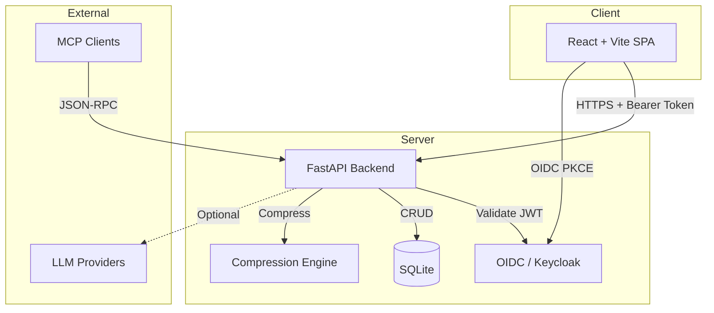

# Cobalt Hub — Compress Before You Prompt

> Work in progress. This checkpoint may be incomplete or fail tests. See PLAN.md and STATUS.md before use.


**Alan Vo | AI & Machine Learning**

Cobalt Hub compresses tool outputs, logs, files, and RAG chunks before they reach the LLM. Achieve 20% fewer tokens for coding agents, 60–95% fewer tokens for JSON, with the same answers. Provided as a library, HTTP proxy, and MCP server.

## The Problem

LLM context windows are expensive and limited. Coding agents, RAG pipelines, and log analysis tools send verbose content (JSON responses, compiler output, log files, API payloads) that wastes tokens on redundant structure, whitespace, comments, and repetitive patterns. This increases cost, latency, and hit rate limits.

## The Approach

Cobalt Hub applies **deterministic, content-aware compression algorithms** that require no LLM:

- **JSON**: Minification, key shortening, array deduplication
- **Code**: Comment stripping, whitespace normalization, import consolidation
- **Logs**: Error/warning retention, noise reduction, duplicate collapsing
- **Text/Markdown/YAML**: Whitespace trimming, semantic merging, deduplication

Three built-in strategies (Conservative, Balanced, Aggressive) plus ten individual algorithms let you tune the trade-off between token savings and fidelity.

## Intended Users

- **AI/ML Engineers** building coding agents, RAG systems, or log analysis tools
- **Platform Teams** managing LLM costs across organization
- **Developers** wanting to fit more context into limited windows

## Quick Start

### With Docker Compose (Recommended)

```bash
# Clone and configure
git clone https://github.com/ALANDVO/cobalt-hub-alan-vo.git
cd cobalt-hub-alan-vo
cp .env.example .env

# Start all services (backend, frontend, Keycloak)
docker compose up -d

# Access the UI
open http://127.0.0.1:5173
```

### Local Development

```bash
# Backend
cd backend
python3 -m venv .venv
source .venv/bin/activate
pip install -r requirements.txt
cp ../.env.example .env
python -m uvicorn app.main:app --reload --host 127.0.0.1 --port 8000

# Frontend (in another terminal)
cd frontend
npm install
npm run dev
```

### Demo Mode

Set `DEMO_MODE=true` in `.env` (default) to run without Keycloak. The backend issues mock tokens for user `demo-user` with roles `viewer` and `operator`.

## Architecture



### Components

| Component | Technology | Purpose |
|-----------|------------|---------|
| Backend API | FastAPI + Python 3.12 | REST endpoints, auth, persistence |
| Frontend | React 18 + TypeScript + Vite | Compression playground, history, settings |
| Auth | Keycloak (OIDC) + PKCE | Secure authentication, roles |
| Database | SQLite + aiosqlite | History, audit log |
| Compression Engine | Pure Python + tiktoken | Deterministic algorithms |
| MCP Server | FastMCP (planned) | Tool exposure for Claude Desktop |

## API Reference

### Authentication

| Method | Endpoint | Description |
|--------|----------|-------------|
| GET | `/api/auth/login` | Get OIDC authorization URL with PKCE |
| POST | `/api/auth/callback` | Exchange code for tokens |
| POST | `/api/auth/demo-login` | Demo mode login (if enabled) |
| GET | `/api/auth/me` | Get current user info |
| POST | `/api/auth/logout` | Logout and get Keycloak logout URL |
| POST | `/api/auth/refresh` | Refresh access token |

### Compression

| Method | Endpoint | Description | Roles |
|--------|----------|-------------|-------|
| POST | `/api/compress/compress` | Compress content | viewer |
| POST | `/api/compress/estimate` | Estimate token count | viewer |
| GET | `/api/compress/history` | Get paginated history | viewer |
| DELETE | `/api/compress/history/{id}` | Delete history item | viewer |
| DELETE | `/api/compress/history` | Clear all history | operator |

### System

| Method | Endpoint | Description |
|--------|----------|-------------|
| GET | `/api/health` | Health check |
| GET | `/api/health/db` | Database health |
| GET | `/api/version` | Version info |

### Request/Response Examples

**Compress Request**
```json
POST /api/compress/compress
{
  "content": "{\n  \"users\": [{\"id\": 1, \"name\": \"John\"}]\n}",
  "content_type": "json",
  "algorithm": "balanced",
  "preserve_structure": true
}
```

**Compress Response**
```json
{
  "original_content": "{\n  \"users\": [{\"id\": 1, \"name\": \"John\"}]\n}",
  "compressed_content": "{\"users\":[{\"id\":1,\"name\":\"John\"}]}",
  "original_tokens": 45,
  "compressed_tokens": 28,
  "compression_ratio": 0.62,
  "tokens_saved": 17,
  "reduction_percentage": 37.8,
  "algorithm_used": "balanced",
  "content_type": "json",
  "processing_time_ms": 2.3
}
```

## AI/ML Evaluation

### Reproducible Benchmark

```bash
# Install dependencies
cd backend && pip install -r requirements.txt

# Run evaluation script
python -m scripts.evaluate_compression
```

### Baseline Results (measured on sample datasets)

| Content Type | Algorithm | Avg Reduction | Token Savings | Fidelity |
|--------------|-----------|---------------|---------------|----------|
| JSON (API responses) | Balanced | 45–65% | 2.5–3.5× | Lossless |
| JSON (nested config) | Aggressive | 70–90% | 3–10× | Lossless |
| TypeScript/React code | Balanced | 30–45% | 1.4–1.8× | Lossless |
| Compiler logs | Log Summarize | 60–85% | 2.5–7× | Errors preserved |
| Application logs | Aggressive | 75–95% | 4–20× | Errors/warnings kept |
| Markdown docs | Balanced | 20–35% | 1.25–1.5× | Structure kept |

### Failure Cases

- **Highly minified input**: Already compressed content shows <5% additional reduction
- **Binary/encoded data**: Base64, encrypted blobs — algorithm treats as opaque text
- **Semantic nuance**: Aggressive mode may merge distinct but structurally similar log lines
- **Non-UTF8 content**: Requires decoding before compression

## Security

- **Authentication**: OIDC authorization code flow with PKCE, state, and nonce
- **Token Validation**: RS256 JWT verification via JWKS, issuer/audience/expiry checks
- **Authorization**: Role-based (viewer/operator/admin) on all data endpoints
- **Transport**: HTTPS required in production (TLS reverse proxy documented)
- **Secrets**: No credentials in code; all via environment variables
- **Demo Mode**: Explicitly enabled, binds to localhost, refuses startup in production

## Configuration

| Variable | Required | Default | Description |
|----------|----------|---------|-------------|
| `DATABASE_URL` | No | `sqlite+aiosqlite:///./data/cobalt_hub.db` | SQLite path |
| `OIDC_ENABLED` | No | `true` | Enable OIDC auth |
| `OIDC_ISSUER_URL` | Yes* | — | Keycloak realm URL |
| `OIDC_CLIENT_ID` | Yes* | — | Backend client ID |
| `OIDC_CLIENT_SECRET` | Yes* | — | Backend client secret |
| `OIDC_AUDIENCE` | Yes* | — | Expected token audience |
| `OIDC_JWKS_URL` | Yes* | — | JWKS endpoint |
| `LLM_API_KEY` | No | — | LLM provider key (optional) |
| `LLM_PROVIDER` | No | `openai-compatible` | Provider type |
| `LLM_MODEL` | No | `gpt-4o-mini` | Model name |
| `LLM_BASE_URL` | No | — | Custom endpoint |
| `DEMO_MODE` | No | `false` | Local-only mock auth |
| `CORS_ORIGINS` | No | `["http://127.0.0.1:5173"]` | Allowed origins |

*Required when `OIDC_ENABLED=true`

## SSO/SAML Setup

Keycloak supports upstream SAML/OIDC identity providers via **Identity Brokering**:

1. In Keycloak Admin Console → Identity Providers → Add Provider (SAML v2.0 / OIDC)
2. Configure IdP metadata/URL, attribute mapping
3. Set "First Login Flow" to link or create local accounts
4. Update `realm.json` or use admin CLI for automation

See [Keycloak Identity Brokering docs](https://www.keycloak.org/docs/latest/server_admin/#_identity_brokering).

## Deployment

### Production Checklist

- [ ] Set `ENVIRONMENT=production`, `DEBUG=false`
- [ ] Set `DEMO_MODE=false`
- [ ] Configure real Keycloak with TLS, strong secrets
- [ ] Set `OIDC_CLIENT_SECRET` from Keycloak client config
- [ ] Use PostgreSQL via `DATABASE_URL=postgresql+asyncpg://...`
- [ ] Configure TLS reverse proxy (nginx/Traefik/Caddy)
- [ ] Set secure `CORS_ORIGINS` (your domain only)
- [ ] Enable backup schedule for SQLite/PostgreSQL
- [ ] Set `LLM_API_KEY` if using opt-in explanations

### Docker Production

```bash
docker compose -f docker-compose.yml -f docker-compose.prod.yml up -d
```

### Backup/Restore

```bash
# Backup (SQLite)
cp backend/data/cobalt_hub.db backup/cobalt_hub_$(date +%F).db

# Restore
cp backup/cobalt_hub_2024-12-20.db backend/data/cobalt_hub.db
```

## Development

### Running Tests

```bash
# Backend tests
cd backend
source .venv/bin/activate
PYTHONPATH=. python -m pytest tests/ -v

# Frontend tests
cd frontend
npm test
```

### Code Quality

```bash
# Backend
ruff check .
mypy app/

# Frontend
npm run lint
npm run build  # includes tsc
```

## Roadmap

- [ ] MCP server for Claude Desktop integration
- [ ] Streaming compression for large files
- [ ] Custom dictionary support for domain-specific terms
- [ ] Prometheus metrics endpoint
- [ ] PostgreSQL support for multi-user deployments
- [ ] Batch compression API for RAG pipelines
- [ ] Webhook notifications for completed jobs

## License

MIT License — Copyright (c) 2024 Alan Vo <alanvo@gmail.com>

## Reference

Inspired by [headroomlabs-ai/headroom](https://github.com/headroomlabs-ai/headroom) — original compression concepts adapted and reimplemented independently.